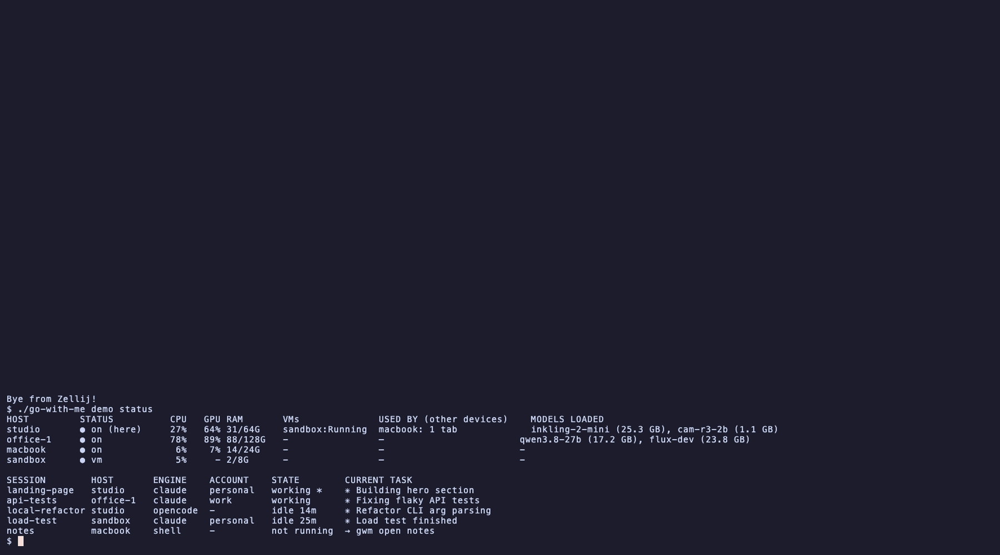

# go-with-me

**One terminal for all your machines, Claude accounts, VMs and local models.**

Your Mac Studio, your work laptop, an office box and a Linux VM become tabs in one window. A live board shows what every machine and agent is doing, and a coordinator Claude can summarise everything and hand work to the right machine.


```bash
git clone https://github.com/Vayras/go-with-me && cd go-with-me && ./go-with-me demo
```
☝️ **Live demo, no setup.** It opens the real hub with pretend machines and agents. No SSH, no logins, and nothing on your computer is touched. (Needs [Zellij](https://zellij.dev): `brew install zellij`.)

---

## What you get

<table>
<tr>
<td width="50%"></td>
<td width="50%"></td>
</tr>
<tr>
<td><b>Just a sidebar and a terminal.</b> <b>This Mac</b> gets a full card: CPU / GPU / RAM bars, <b>every loaded model</b> and its size, VMs, which other devices are using it, and its running sessions. <b>Other machines</b> get compact cards with their models and sessions. Only sessions that are <i>running</i> are listed; saved ones collapse to one line. Tab 1 is the <b>coordinator</b>: a terminal where typing <code>claude</code> gives you an assistant that can see and steer every machine.</td>
<td><b>Click a session to jump in</b> (a stopped one starts). Each session runs on its own machine and <b>keeps running</b> when you close your laptop. <b>Alt+1…9</b> also jumps; <b>n</b> new, <b>x</b> close. Select text with the mouse to copy it.</td>
</tr>
</table>

A **session** is *machine + engine + account + folder*:

| | |
|---|---|
| **Machines** | Any Mac (or Linux box), connected over [Tailscale](https://tailscale.com) (works anywhere, no Remote Login) or plain SSH with Remote Login |
| **Terminals, not auto-launched apps** | Every tab is a plain terminal; **nothing starts on its own**. A session's engine (`claude`, `opencode` with local models on [oMLX](https://github.com/jundot/omlx) or [Ollama](https://ollama.com), or `shell`) just labels what it's for and shows a hint; you type `claude` / `opencode` when you want it |
| **Accounts** | Several Claude logins side by side: in a `work` tab, typing `claude` uses your work login, and in a `personal` tab your personal one |
| **Web** | The same hub in a browser on any of your Tailscale devices (`gwm web`): same sidebar, same terminals, same keys. Tailnet-only HTTPS plus a login token |
| **VMs** | `gwm vm create sandbox --on studio` makes a Linux VM ([Lima](https://lima-vm.io)) on your strongest machine; it shows up as a machine with its own sessions |



Outside the hub, `gwm status` prints the same information as a table, and `gwm who` lists which devices are connected to which machine.

## Quick start

```bash
brew install zellij tmux
git clone https://github.com/Vayras/go-with-me ~/go-with-me && ~/go-with-me/install.sh   # adds `gwm`
gwm tailscale   # optional, recommended: connect your Macs from anywhere, no Remote Login needed
gwm init        # name this Mac
gwm add         # add your other Macs (Tailscale or Remote Login): sets up access both ways, installs everything there
gwm             # open the hub
```

**Two ways to connect your Macs:** **Tailscale** (works anywhere, no Remote Login, no SSH keys) or **Remote Login** (plain SSH on the same Wi-Fi). Mix and match. **📖 Full guide and troubleshooting: [docs/SETUP.md](docs/SETUP.md)**

## Everyday use

| Do this | Command |
|---|---|
| Open the hub (only running sessions get a tab; nothing new is started) | `gwm` |
| Start a new session (asks machine / engine / account / folder) | `gwm new` |
| Start a session on **any machine on your tailnet** (new ones are set up for you: tmux, go-with-me, your config) | `gwm new --on <tailnet-name>` · `gwm tailnet` lists them |
| Open a tab for a session that isn't running | `gwm open <session>` |
| Close a session and its tab (its screen is saved to `~/.config/go-with-me/archive/` first; Claude chats are kept) | `gwm close <session>` |
| Stop it but keep the tab (Enter in the tab restarts it) | `gwm stop <session>` |
| Start a session **with its agent running** (optionally a first task) | `gwm spawn fix-tests --on macbook --prompt "run the tests and fix failures"` |
| See closed sessions · bring one back with its Claude conversation | `gwm archive` · `gwm resume <session>` |
| See everything at a glance / who's using what | `gwm status` · `gwm who` |
| Read or type into a session from anywhere | `gwm peek <session>` · `gwm send <session> "text"` |
| Read a session's whole Claude conversation (the coordinator does this for every chat by default) | `gwm history <session>` · `gwm history --all` |
| Add / remove a machine | `gwm add [--via tailscale\|ssh]` · `gwm remove <machine>` |
| Set up Tailscale on this Mac | `gwm tailscale` |
| Run a command on a machine | `gwm run <machine> "git status"` |
| Sign a Claude account in on a machine | `gwm login work --on studio` |
| Linux VMs | `gwm vm create <name> --on <machine> [--cpus 6 --memory 16]` · `gwm vm list` |
| Local models | `gwm models --on studio` · `gwm pull <model>` · `gwm opencode-setup --on studio` |
| Copy text | Select it with the mouse; it's copied automatically. Paste with Cmd+V |
| Paste a screenshot (or files copied in Finder) into a session on **another machine** | **⌥V** in its tab · `gwm paste [session]` · `gwm paste --last` (newest screenshot file) |
| Send files to a session's machine, from here or from another session | `gwm share report.pdf studio-work` · `gwm share studio:out/chart.png macbook-claude` |
| Give every machine's Claude a browser (a Chrome window on this Mac) | `gwm chrome` · `gwm chrome status` · `gwm chrome stop` |
| Open the hub in a browser (your tailnet only) | `gwm web` · `gwm web stop` · `gwm web token` |
| Leave the hub (everything keeps running) | **⌥Q**, or close the window |

**Shortcuts** (⌥ = Option; in Terminal.app run `gwm keys --setup` once so ⌥ works):

| | |
|---|---|
| **⌥1…9** · **⌥← ⌥→** | jump to a tab · previous / next |
| **⌥S** | switch between sidebar and terminal |
| **⌥N** · **⌥X** · **⌥Z** | new pane · close pane · zoom pane |
| **⌥O** | open or create a session |
| **⌥V** | paste a screenshot / copied files into this tab's session (any machine) |
| **⌥Q** | leave (everything keeps running) |
| **⌥/** | show all shortcuts (`gwm keys`) |

Click anything in the sidebar too. Select text to copy it.

## Screenshots, files and a browser for remote sessions

Claude Code reads the clipboard of the machine **it runs on**, so ⌃V-ing a screenshot into a session on the Studio
gets nothing. Instead, press **⌥V** in that tab (or run `gwm paste`). It copies the image to that machine's inbox
(`~/.cache/go-with-me/inbox/`, cleared after 7 days) and types its path into the prompt, where Claude Code attaches
it as an image. Then press Enter. With no image on the clipboard, it offers your newest screenshot file. Files copied
in Finder (⌘C) work too. `gwm share` does the same for any file or folder, including ones on another machine
(`session:path` or `machine:path`). Add `--no-type` to copy without typing anything into the session.

`gwm chrome` opens a separate Chrome window on the Mac you're at and lets Claude on every machine drive it, through
[chrome-devtools-mcp](https://github.com/ChromeDevTools/chrome-devtools-mcp) (added to Claude Code on each machine as
`gwm-chrome`, for each account its sessions use; restart `claude` in sessions that were already running).
Chrome listens on `127.0.0.1:9339` only, and each other machine reaches it through an SSH reverse tunnel bound to
*its* `127.0.0.1`, so nothing is exposed on the network. Anything running on those machines as any user can drive
that browser while it's shared, so it uses its own profile: sign in there only to what agents should use. Sharing
ends when you quit that window or run `gwm chrome stop`. Lima VMs aren't supported yet.

## gwm-desktop (native Mac app)

`gwm-desktop/` is a native macOS app in Rust (egui + alacritty's terminal engine) with a Zed-style layout:
your machines in a sidebar, each with its sessions grouped under it (live state: working / idle / not started),
sessions as tabs, a command palette (**⌘K**), and a status bar. It runs the same `gwm` underneath. Each tab is
`gwm attach <session>`, so sessions keep running on their machines when you close a tab or quit.

- **New session anywhere:** ⌘T, "+ new session" in a machine's group, or a machine under *On your tailnet*.
  Machines that aren't set up yet are set up for you (tmux, go-with-me, your config). The session shows up
  right away and turns into a terminal when it's ready.
- **Screenshots and files:** ⌘V pastes a screenshot or files copied in Finder into the session (any machine),
  ⌘⇧V sends your newest screenshot, and you can drop files on a tab.
- **Browser:** the title-bar toggle shares a Chrome window with every machine (`gwm chrome`).
- Keys: ⌘1…9 tabs · ⌘W close tab · ⌘B sidebar · ⌘= / ⌘- text size · ⇧↵ newline in Claude · ⌥ works as Meta.

```bash
cd gwm-desktop && ./bundle.sh --install   # builds gwm-desktop.app into ~/Applications (needs Rust: rustup.rs)
```

## Web access

```bash
gwm web            # prints https://<this-mac>.<tailnet>.ts.net:8443/gwm and, the first time, a login token
gwm web stop       # stop sharing (your hub and sessions keep running)
```

It's the same hub (sidebar + terminals) through [Zellij's web client](https://zellij.dev), with four layers of protection:

1. **Local only.** The web server listens on `127.0.0.1`, so nothing on your Wi-Fi or the internet can connect to it. `gwm web` refuses to continue if it's ever bound wider.
2. **Your tailnet only.** [Tailscale Serve](https://tailscale.com/kb/1312/serve) publishes it over HTTPS with a real `*.ts.net` certificate to the devices your tailnet's access rules allow to reach this Mac (just yours, in a personal tailnet; check your rules if you share nodes or have teammates). It's Serve, not Funnel, so it's never on the public internet. `gwm web stop` always removes the route; it would otherwise survive reboots.
3. **Login token.** Every browser logs in with a token (`gwm web token`). Use `--read-only` for watch-only access, and `gwm web revoke <name>` revokes one; revoking also logs out browsers already using it.
4. **Only the hub is shared.** Web sharing is enabled for the go-with-me hub, not for your other terminal sessions.

A token is a terminal on that Mac, so treat it like a password. One-time setup: turn on **HTTPS Certificates** in your [Tailscale DNS settings](https://login.tailscale.com/admin/dns).

## Config

`~/.config/go-with-me/hosts.conf`
```
# name   | ssh target         | role (the coordinator reads this)
studio   | you@my-mac-studio  | Home Mac Studio, 64GB. Always on. Local models, VMs.
macbook  | you@my-macbook     | Work laptop; may be asleep.
sandbox  | vm:studio/sandbox  | Linux VM on studio
```
`~/.config/go-with-me/sessions.conf`
```
# name        | machine | engine   | account | folder
site          | studio  | claude   | default | ~/code/site
work-api      | studio  | claude   | work    | ~/work/api
local         | studio  | opencode | -       | ~/code
```
`gwm init`, `gwm add`, `gwm new` and `gwm close` edit these for you, and `gwm add` copies them to your other machines.

## How it works

Plain bash, no daemon or server:

- **Zellij** draws the hub on the machine you're sitting at: a Python **sidebar** (curses) beside each session's terminal.
- Each session lives in a **hidden tmux** on its own machine (no status bar, no prefix key; it's only there so sessions survive disconnects). Tabs reconnect to it over **SSH**.
- The sidebar's data comes from one shared SSH sweep of every machine (cached a few seconds): CPU/RAM, loaded local models (oMLX and/or Ollama), Lima VMs, tmux sessions, and incoming SSH/Tailscale connections (that's **in use**).
- **Accounts** = a separate `CLAUDE_CONFIG_DIR` per label on each machine.
- The **coordinator** tab is a terminal in `coordinator/`; when you run `claude` there it reads `CLAUDE.md` and uses `gwm status / peek / send / run`. It asks before sending to a session or changing anything.

## Similar projects

The pieces of go-with-me exist elsewhere; the combination is what's different. Worth a look:

| Project | Overlap |
|---|---|
| [herdr](https://github.com/ogulcancelik/herdr) | The closest: a terminal multiplexer for agents, with remote machines over SSH and agent status per pane. Much more mature. |
| [AI Maestro](https://github.com/23blocks-OS/ai-maestro), [Codeman](https://github.com/Ark0N/Codeman), [ADHDev](https://github.com/vilmire/adhdev), [Agent Deck](https://github.com/asheshgoplani/agent-deck) | Multi-machine agent dashboards (mostly web UIs) |
| [Claude Code Remote Control](https://code.claude.com/docs/en/remote-control) | Anthropic's way to reach your sessions from claude.ai and your phone |
| [ccswap](https://github.com/vvinhas/ccswap), [claude-switch](https://github.com/hoangvu12/claude-switch) | Claude multi-account switching on one machine |

**go-with-me's angle:** a *machine-level* board (resources, local models, VMs, who's connected), **per-session Claude accounts** mixed across machines, **local models and Lima VMs as first-class citizens**, and a coordinator that works over your own SSH. It's all in the terminal and simple enough to read in one sitting.

**Not there yet:** phone and web access, "needs your input" alerts, git worktree isolation, cost tracking, and restoring layouts after a reboot. PRs welcome.

## Security notes

- **The coordinator reads every Claude chat** on every machine and account (including work accounts) by default, and it can run commands everywhere. Text it reads could try to steer it (prompt injection), so `coordinator/.claude/settings.json` makes Claude **always ask you** before `gwm run`, `gwm send`, `ssh`, or anything that creates, closes or deletes. Keep it that way, and avoid auto mode in the coordinator.
- `gwm send` / `gwm run` execute on your machines over SSH. Treat the coordinator like any agent with shell access.
- Lima VMs mount your home folder **read-only** by default, which makes them good sandboxes.
- Check your employer's policy before joining work machines or work accounts.

## Status

Early, and built for macOS (Linux works for VMs and remote machines). The VM commands are new and lightly tested. Issues and PRs welcome.

## License

MIT
