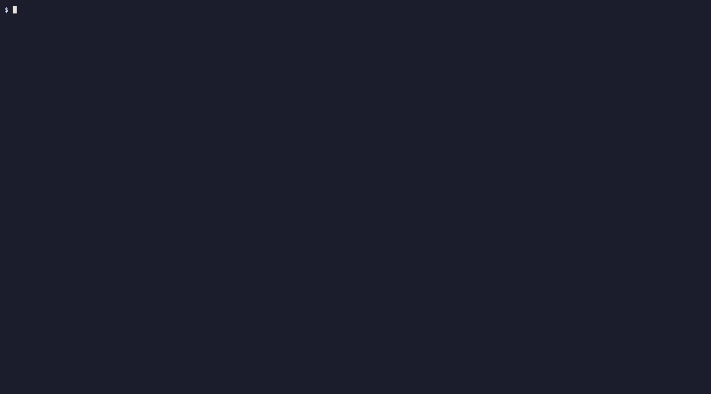

# go-with-me

**One terminal for all your machines, Claude accounts, VMs and local models.**

Your Mac Studio, your work laptop, an office box and a Linux VM become tabs in one window. A live board shows what every machine and agent is doing, and a coordinator Claude can summarise everything and hand work to the right machine.



```bash
git clone https://github.com/Vayras/go-with-me && cd go-with-me && ./go-with-me demo
```
☝️ **Live demo, no setup.** It opens the real hub with pretend machines and agents. No SSH, no logins, and nothing on your computer is touched. (Needs [Zellij](https://zellij.dev): `brew install zellij`.)

---

## What you get

<table>
<tr>
<td width="50%"></td>
<td width="50%"></td>
</tr>
<tr>
<td><b>Overview tab.</b> A <b>sidebar</b> on the left of every tab lists your machines and sessions with live status; click one to jump there, or use + new / × close. Every machine (CPU, RAM, loaded models, VMs, <i>which other devices are using it</i>) and every session (working / idle / current task). Below it, a <b>coordinator</b> Claude you can ask "what's going on?" or "tell the VM to rerun the load test".</td>
<td><b>One tab per session.</b> Each session runs on its own machine and <b>keeps running</b> when you close your laptop. Tabs are numbered by position and renumber themselves; <b>Alt+1…9</b> jumps straight to one.</td>
</tr>
</table>

A **session** is *machine + engine + account + folder*:

| | |
|---|---|
| **Machines** | Any Mac (or Linux box), connected over [Tailscale](https://tailscale.com) (works anywhere, no Remote Login) or plain SSH with Remote Login |
| **Engines** | `claude` (Claude Code), `opencode` (local models via [Ollama](https://ollama.com), no cloud tokens), `shell` |
| **Accounts** | Several Claude logins side by side, e.g. `personal` on one tab and `work` on another, each fully separate |
| **VMs** | `gwm vm create sandbox --on studio` makes a Linux VM ([Lima](https://lima-vm.io)) on your strongest machine; it shows up as a machine with its own sessions |


`gwm status` shows the same board in any terminal. `gwm who` tells you which devices are connected to which machine.

## Quick start

```bash
brew install zellij tmux
git clone https://github.com/Vayras/go-with-me ~/go-with-me && ~/go-with-me/install.sh   # adds `gwm`
gwm tailscale   # optional, recommended: connect your Macs from anywhere, no Remote Login needed
gwm init        # name this Mac
gwm add         # add your other Macs (Tailscale or Remote Login): sets up access both ways, installs everything there
gwm             # open the hub
```

**Two ways to connect your Macs:** **Tailscale** (works anywhere, no Remote Login, no SSH keys) or **Remote Login** (plain SSH on the same Wi-Fi). Mix and match. **📖 Full guide and troubleshooting: [docs/SETUP.md](docs/SETUP.md)**

## Everyday use

| Do this | Command |
|---|---|
| Open the hub (only running sessions get a tab) | `gwm` |
| Start a new session (asks machine / engine / account / folder) | `gwm new` |
| Open a tab for a session that isn't running | `gwm open <session>` |
| Close a session and its tab | `gwm close <session>` |
| Stop it but keep the tab (Enter in the tab restarts it) | `gwm stop <session>` |
| See everything at a glance / who's using what | `gwm status` · `gwm who` |
| Read or type into a session from anywhere | `gwm peek <session>` · `gwm send <session> "text"` |
| Add / remove a machine | `gwm add [--via tailscale\|ssh]` · `gwm remove <machine>` |
| Set up Tailscale on this Mac | `gwm tailscale` |
| Run a command on a machine | `gwm run <machine> "git status"` |
| Sign a Claude account in on a machine | `gwm login work --on studio` |
| Linux VMs | `gwm vm create <name> --on <machine> [--cpus 6 --memory 16]` · `gwm vm list` |
| Local models | `gwm models --on studio` · `gwm pull <model>` · `gwm opencode-setup --on studio` |
| Copy text | Select it with the mouse; it's copied automatically. Paste with Cmd+V |
| Leave the hub (everything keeps running) | **Ctrl+g → o → d**, or close the window |

**In the hub:** the **sidebar** (left) lists every machine and session: click to jump, **n** new, **x** close, **?** help. Click tabs and panes with the mouse; select text to copy. Keys go straight to Claude or opencode until you press **Ctrl+g**; the bottom bar then shows what each key does. **Alt+1…9** and **Alt+←/→** switch tabs at any time (Terminal.app: enable *Use Option as Meta key*).

## Config

`~/.config/go-with-me/hosts.conf`
```
# name   | ssh target         | role (the coordinator reads this)
studio   | you@my-mac-studio  | Home Mac Studio, 64GB. Always on. Local models, VMs.
macbook  | you@my-macbook     | Work laptop; may be asleep.
sandbox  | vm:studio/sandbox  | Linux VM on studio
```
`~/.config/go-with-me/sessions.conf`
```
# name        | machine | engine   | account | folder
site          | studio  | claude   | default | ~/code/site
work-api      | studio  | claude   | work    | ~/work/api
local         | studio  | opencode | -       | ~/code
```
`gwm init`, `gwm add`, `gwm new` and `gwm close` edit these for you, and `gwm add` copies them to your other machines.

## How it works

Plain bash, no daemon or server:

- **Zellij** draws the hub on the machine you're sitting at.
- Each session lives in a **hidden tmux** on its own machine (no status bar, no prefix key; it's only there so sessions survive disconnects). Tabs reconnect to it over **SSH**.
- The board polls every machine over SSH every 5 s: CPU/RAM, Ollama's loaded models, Lima VMs, tmux sessions, and incoming SSH connections (that's the **used by** column).
- **Accounts** = a separate `CLAUDE_CONFIG_DIR` per label on each machine.
- The **coordinator** is a normal Claude Code session with instructions to use `gwm status / peek / send / run`. It asks before sending to a session or changing anything.

## Similar projects

The pieces of go-with-me exist elsewhere; the combination is what's different. Worth a look:

| Project | Overlap |
|---|---|
| [herdr](https://github.com/ogulcancelik/herdr) | The closest: a terminal multiplexer for agents, with remote machines over SSH and agent status per pane. Much more mature. |
| [AI Maestro](https://github.com/23blocks-OS/ai-maestro), [Codeman](https://github.com/Ark0N/Codeman), [ADHDev](https://github.com/vilmire/adhdev), [Agent Deck](https://github.com/asheshgoplani/agent-deck) | Multi-machine agent dashboards (mostly web UIs) |
| [Claude Code Remote Control](https://code.claude.com/docs/en/remote-control) | Anthropic's way to reach your sessions from claude.ai and your phone |
| [ccswap](https://github.com/vvinhas/ccswap), [claude-switch](https://github.com/hoangvu12/claude-switch) | Claude multi-account switching on one machine |

**go-with-me's angle:** a *machine-level* board (resources, local models, VMs, who's connected), **per-session Claude accounts** mixed across machines, **local models and Lima VMs as first-class citizens**, and a coordinator that works over your own SSH. It's all in the terminal and simple enough to read in one sitting.

**Not there yet:** phone and web access, "needs your input" alerts, git worktree isolation, cost tracking, and restoring layouts after a reboot. PRs welcome.

## Security notes

- `gwm send` / `gwm run` execute on your machines over SSH. Treat the coordinator like any agent with shell access.
- Lima VMs mount your home folder **read-only** by default, which makes them good sandboxes.
- Check your employer's policy before joining work machines or work accounts.

## Status

Early, and built for macOS (Linux works for VMs and remote machines). The VM commands are new and lightly tested. Issues and PRs welcome.

## License

MIT
